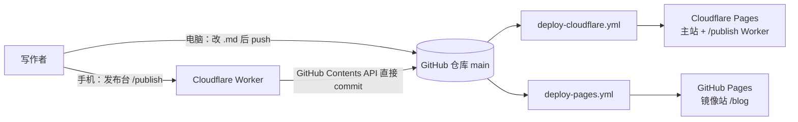

# Albert's Blog

> 独立思考，诚实书写。
> 一个没有后台、没有数据库、内容全部是 Git 仓库里 Markdown 文本的个人站点。

[](https://github.com/JLUAlbert/blog/actions/workflows/deploy-cloudflare.yml)
[](https://github.com/JLUAlbert/blog/actions/workflows/deploy-pages.yml)
[](LICENSE)

| 入口                         | 地址                                       |
| ---------------------------- | ------------------------------------------ |
| **主站**（Cloudflare Pages） | <https://jlualbert-blog.pages.dev/>        |
| 镜像站（GitHub Pages）       | <https://jlualbert.github.io/blog/>        |
| **发布台**（手机写稿）       | <https://jlualbert-blog.pages.dev/publish> |
| 源码仓库                     | <https://github.com/JLUAlbert/blog>        |

---

## 这是什么

一个基于 [Astro](https://astro.build) 与 Navfolio 主题包的静态站点，三个栏目：

- **Blog** — 长文：读书笔记、影评、社会观察。文章有独立页面，支持分类、系列、标签、归档与分页。
- **Vibe** — 短记录：诗词与碎片，按时间线呈现，没有独立文章页。
- **Movies** — 片单：海报卡片按观看时间排列，数据由 Trakt 同步生成，块外可写自己的笔记。

阅读体验上的细节：纸感墨绿配色与 8 套色盘、深色模式、霞鹜文楷正文（界面字体做子集按需加载）、KaTeX 公式、Mermaid 图、代码块行号与折叠、Giscus 评论、Pagefind 全站搜索（`Ctrl/⌘ + K`）、正文图片点击放大、分享预览图与 RSS/sitemap/robots。动效克制：只有页面元素的 Blur In 与卡片／影片／顶栏的 Hover Lift，系统开启「减少动态效果」时自动退化为静态。

---

## 它怎么运转



一次 `push` 到 `main`，两条 workflow 并行构建、同时上线。发布台不需要服务器：它是一个 Cloudflare Worker，验证口令后用 GitHub Contents API 把文章写成仓库里的 `.md` 文件，这次 commit 反过来触发上面两条部署流程——所以手机上发一篇，两分钟后在两个站点都能看到。

构建产物是纯静态 HTML：Astro 渲染页面 → Pagefind 生成搜索索引 → sitemap/RSS 输出。两个平台的差异只有一处：GitHub Pages 挂在 `/blog` 子路径下，Cloudflare 在根路径。这由 `DEPLOY_TARGET` 与 `SITE_URL` 在构建时决定（见下文「部署配置」）。

---

## 发布台 /publish

浏览器打开 <https://jlualbert-blog.pages.dev/publish>，输入口令解锁即可写稿。字段顺序刻意保持极简：

**栏目 → 标题 → 正文 → 摘要 → 标签 → 系列 / 日期 → 网址别名 → 配图**

- 栏目 `blog` / `vibe`；`vibe` 只写 title、date、tags、draft，不生成 description 与 series。
- 日期留空 = 发布当刻（北京时间，精确到秒）；网址别名留空 = 用发布日期做 URL。同一天再发一篇会自动顺延 `-2`、`-3`，不会覆盖前一篇。
- 配图上传到 `public/images/`，正文里自动插入图片引用。
- **历史**里可以搜索、点开任意一篇继续编辑；编辑时不会改动原有的 URL 与日期。
- 勾选草稿会写入 `draft: true`，站点不会展示。

> 口令只从 Cloudflare Pages 的环境变量 `PUBLISH_PASSWORD` 读取，代码里不留默认值（本仓库公开）。改口令在 Cloudflare 控制台改环境变量即可，不用改代码。

实现在根目录 `_worker.js`：同时包含表单 HTML、样式与客户端脚本，以及 `/publish` 的 GET/POST、历史列表、单篇读取接口。部署时由 workflow 复制成 `dist/_worker.js` 一起上传。

---

## 目录导览

| 路径                             | 作用                                                                      |
| -------------------------------- | ------------------------------------------------------------------------- |
| `src/config/site.toml`           | **最常改的文件**：站点信息、导航、文案、色盘、字体、评论、首页配置        |
| `src/content/blog/`              | 长文 Markdown                                                             |
| `src/content/vibe/`              | 短记录 Markdown                                                           |
| `src/content/movie/`             | 片单 Markdown（`<!-- trakt:begin/end -->` 之间由同步脚本管理）            |
| `src/pages/`                     | 首页、Blog 列表/分页/分类/系列/标签、Movies、404、RSS                     |
| `src/styles/`                    | 全局样式；`theme-overrides.css` 覆盖主题包生成的页面，`motion.css` 管动效 |
| `src/styles/theme-overrides.css` | 主题包页面（如 Vibe）无法直接改组件源码时的全局覆盖                       |
| `public/`                        | favicon、字体、头像、文章配图、robots.txt、旧链接重定向表                 |
| `_worker.js`                     | 发布台 Worker（唯一实现）                                                 |
| `astro.config.mjs`               | 站点地址推导、站内绝对路径重写、全局注入样式与脚本                        |
| `.github/workflows/`             | 两条部署 workflow + 片单同步（由发布台触发）                              |
| `scripts/trakt-sync.mjs`         | 从 Trakt 拉取片单并生成 Markdown                                          |

主题包（`@navfolio/*`）通过 GitHub spec 安装，页面与组件大多来自它们。凡是本地能覆盖的都写在 `src/`；主题包源码不直接修改，升级时不会被覆盖。

---

## 本地开发

需要 **Node 24**（`.nvmrc` 与 CI 一致）。

```bash
npm install          # 或 bun install
npm run dev          # http://localhost:4321
npm run build        # astro build + pagefind 索引，产物在 dist/
npm run preview      # 预览 dist/
```

常用内容命令（骨架命令内部调用 Bun，本机需装 Bun；日常写稿更推荐直接用发布台）：

```bash
npm run post:new     # 新建长文骨架
npm run vibe:new     # 新建短记录骨架
node scripts/trakt-sync.mjs --fixture=scripts/.trakt-fixture.json   # 用底稿离线重建片单 Markdown
```

字体子集化是可选的一次性操作：`python3 -m venv .venv && .venv/bin/python -m pip install fonttools brotli`，之后 `npm run fonts:ui`。生成的 `public/fonts/LXGWWenKai-ui-subset.woff2` 需要提交到仓库，否则线上会回退加载全量字体。

提交前 husky 会跑 `format:check`；改动较多时先 `npm run format`。

---

## 部署配置

### GitHub Secrets（仓库 Settings → Secrets and variables → Actions）

| 名称                    | 用途                               |
| ----------------------- | ---------------------------------- |
| `CLOUDFLARE_API_TOKEN`  | Cloudflare API Token（Pages:Edit） |
| `CLOUDFLARE_ACCOUNT_ID` | Cloudflare 账户 ID                 |

片单同步不需要 Actions secret，也不需要 Trakt 账号授权：`scripts/.trakt-fixture.json` 只存公开数据与详情缓存，不含任何凭据；仓库任务只做离线渲染。

可选的仓库变量：`SITE_URL`（主站域名，不设置时默认 `https://jlualbert-blog.pages.dev`）、`CLOUDFLARE_PROJECT`（默认 `jlualbert-blog`）。

### Cloudflare Pages 环境变量

| 名称               | 用途                                                        |
| ------------------ | ----------------------------------------------------------- |
| `GH_TOKEN`         | 发布台用来 commit 文章的 GitHub PAT（repo + workflow 权限） |
| `PUBLISH_PASSWORD` | 发布台口令                                                  |
| `SITE_URL`         | 主站地址，发布成功后返回的文章链接用它拼接                  |

### 地址是怎么推导的

`astro.config.mjs` 按 `DEPLOY_TARGET` 分流，两条 workflow 各自显式传入：

| workflow                | `DEPLOY_TARGET` | `site`                              | `base`    |
| ----------------------- | --------------- | ----------------------------------- | --------- |
| `deploy-cloudflare.yml` | `cloudflare`    | `SITE_URL`                          | `/`       |
| `deploy-pages.yml`      | `github-pages`  | `https://<owner>.github.io/<repo>/` | `/<repo>` |

`site` 必须以 `/` 结尾：主题用 `new URL('rss.xml', Astro.site)` 拼 RSS 地址，少了尾斜杠会把 `/blog` 当成文件名丢掉。Markdown 正文里 `/images/...`、`/blog/...` 这类绝对路径在构建时会自动补上 `base`，因此同一份内容在两个平台都不会 404。

`public/_redirects` 里的旧文章地址跳转只在 Cloudflare Pages 生效；GitHub Pages 不支持该文件，镜像站访问旧链接会 404。主站是权威站点，`robots.txt` 的 Sitemap 也指向主站。

---

## 内容写法

一篇长文的 frontmatter：

```yaml
---
title: 文章标题
description: 一句话摘要
date: 2026-11-04T20:15:00+08:00
slug: custom-url # 可省略，默认等于日期
tags:
  - 随笔
series:
  - 投资笔记
draft: false
---
正文……
```

- 文件名与 URL 默认都是发布日期 `YYYY-MM-DD`；显式 `slug` 会覆盖 URL。
- 配图放 `public/images/`，正文写 ``，构建时会自动补 base。
- `<!-- trakt:begin -->` 与 `<!-- trakt:end -->` 之间的片单内容由同步脚本管理，块外可以写自己的笔记，重跑不会丢。

片单同步：**在发布台点「同步片单」即可**，不需要进 GitHub 或 Cloudflare。Movies 页面读的是仓库里生成好的 Markdown，不依赖 Trakt 实时在线。

片单数据来自 Trakt 的**公开只读接口**（`/users/albert-chan/history`、`/ratings`、`/watched/*`），只需要应用 ID，不需要 OAuth 授权，因此**不占用 Trakt 免费账户唯一的一个社区应用连接名额**——那个名额可以留给 mpv 之类的播放器。Trakt 前面的防护会拦云端服务器（GitHub Actions、Cloudflare Worker）的出口 IP，所以取数放在**点按钮时的浏览器**里完成：接口允许跨域，用户自己的网络不会被限流。发布台只把浏览器精简后的观看记录、评分、观看统计与详情写回 `scripts/.trakt-fixture.json`，然后触发 `.github/workflows/trakt-sync.yml` **离线**渲染 Markdown 并 push。

这次 push 用的是 Actions 自带令牌，按 GitHub 规则不会再触发 push 事件；因此两条部署流水线另外监听 `workflow_run: Trakt sync / completed`，在片单生成完成后用 `main` 最新提交重新构建。底稿单独变更被 `paths-ignore` 排除，不会产生「构建旧片单」的无效部署。发布台把进度分成「片单已生成」和「两个站点都已上线」两级，任一平台失败都会点名提示。

底稿里**没有任何账号凭据**，也不再有 7 天续期这回事，不需要人工维护。前提是 Trakt 资料保持公开（`private=false`）；若日后设为私有，公开接口会读不到，需要改回 OAuth 或升级 Trakt VIP。备用入口：[Trakt sync 工作流](https://github.com/JLUAlbert/blog/actions/workflows/trakt-sync.yml) 的 `Run workflow`（会用当前底稿重建片单），或本地 `node scripts/trakt-sync.mjs --fixture=scripts/.trakt-fixture.json`。

---

## 维护备忘

- **改文案/导航/社交链接**：只改 `src/config/site.toml`，push 即上线。
- **改主题包生成页面的样式**（如 Vibe）：写进 `src/styles/theme-overrides.css`，由 `astro.config.mjs` 全局注入；不要改 `node_modules`。
- **换发布台口令**：Cloudflare Pages → Settings → Environment variables，改 `PUBLISH_PASSWORD`，无需重新部署代码。
- **文章链接变了**：在 `public/_redirects` 加一条 301，仅对主站生效。
- **评论**：Giscus 数据存在本仓库 Discussions，浅色主题 CSS 放在 `public/giscus-light-transparent.css`，配置里写本站相对路径，由组件按当前域名与 base 解析，两个平台各自独立。
- **悬停上浮幅度**：全站统一由 `src/styles/theme-overrides.css` 的 `--hover-lift` 控制（当前 3px），顶栏、首页导航卡、Movies 影片卡共用。

---

## License

代码基于上游 Navfolio 主题（[MIT](LICENSE)），字体与主题包各自遵循其上游许可；站内文章内容归作者所有。
