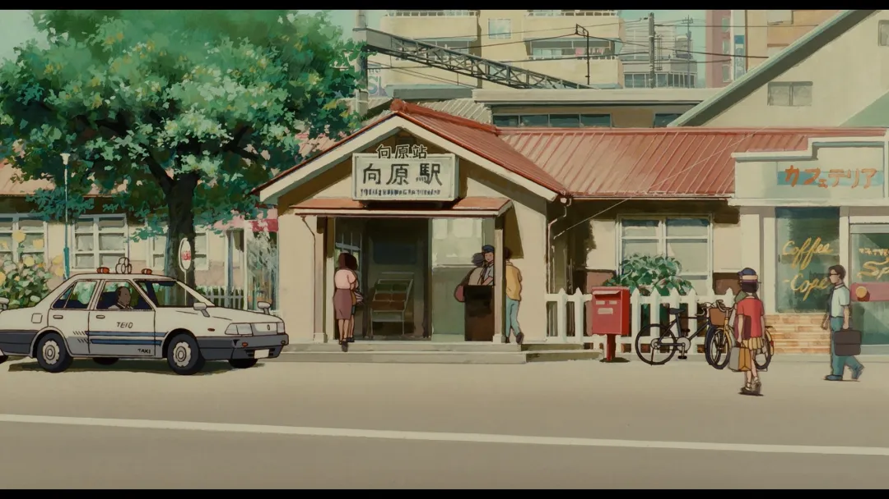
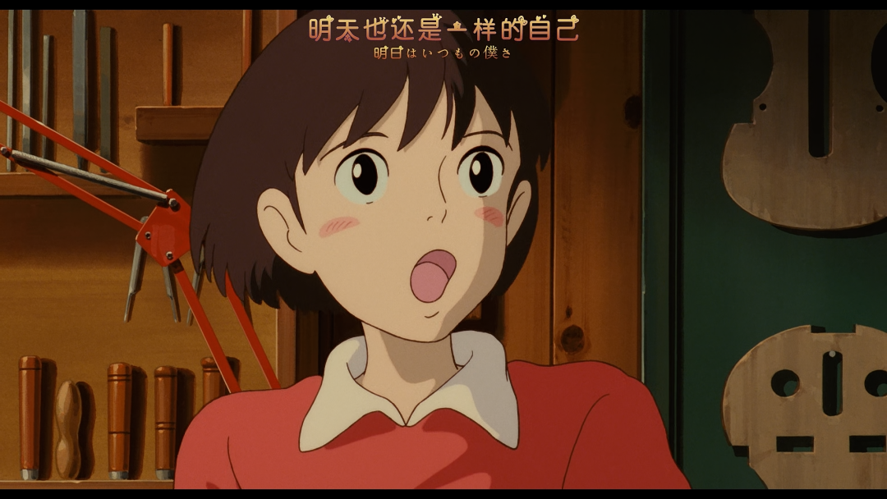

1995年吉卜力工作室的《侧耳倾听》，设定的是学生时代初恋故事，温馨动人，影片以John Denver的《Take Me Home, Country Roads》开头，也以此结尾。

看这部电影实际上是心神不宁的，可以说至少没有Country Roads那般悠闲释然自得，这几天发生的事情和一些争辩在脑海中回想，好像最近一些思考和举动行为都背离了“做人最重要的是开心”这个道理，反而朝着我不认同的所谓的“痛苦的清醒”上走去了，而不是“快乐的糊涂”。

我认为最珍贵的东西，近乎天真幼稚的纯粹和乐观，和由此带来的快乐和信心。

很奇怪，我为什么要写东西？之前尝试过个人博客，但是发现个人的网址在有些地方打不开，然后转战微信公众号，实际上我是不是把其当作云盘来用呢？但是当作云盘的话，为什么不在语雀、金山文档等更私密的地方来写呢？那其实因为还是我想便于分享给别人（以此彰显炫耀自己？）。

但是这个念头确实很可怕，因为一旦有文字（甚至还包括某些图片）在这种公共网络上留存，就会不可避免地出现一些拿着聚光灯和放大镜的人，就像在出租屋拿着灯定损的人一样， 他们不关心你写了什么，更不关心你的本意，只关心自己想关心的东西，甚至硬扯瞎掰。

因此所谓的关注和粉丝，对于一些大V来说，如果有1000万，那就有1000万个风险和潜在的麻烦，甚至就电影这件事来说，也有人去评价这个是水军，那个是黑水军。甚至就算只有10个，也必然有几个有不同的意见。

想起高中时候经常和别人提起的一个故事，那时候我还常常以那个故事标榜自己是个好人。

一个村里如果所有人都说他是好人，那他是好人吗？不是。一个村里如果所有人都说他是坏人，那他是坏人吗？不是。这要看这个村子里的人到底组成是怎么样的，如果这个村子是威虎山、黑风寨，那整个村子里的人都说是好人的人反而是坏人，都说是坏人的人反而是好人了。如果这个村子是稷下学宫，那说好人的都是好人，说坏人的都是坏人了。

现实情况往往不会那么极端，但是社会的组成肯定是有好有坏，当然好人占大多数，坏人占少数，但是推及广之不一定了，认同你的人不一定占大多数，不认同你的人也不一定占少数，而又往往是不爽的声音更有流量和冲动去反对某种观点。

所以我应该抛却那样的念头。

那应该从此为止，停止群发通知，就把其当个云盘来用，写一些想法，甚至是在别处看到的心得。但写作或者说组织语言，确实是对我有益，它能够帮助我安神静心，能够让我总结和反省，但是和创作确实没什么关系，在当今的创作，风向应该是短视频。

记录生活又受限于太冷了，哈哈，我总是爱给自己找借口。

谈谈电影吧，其实应该多看些动画片，哎，是不是应该叫动漫电影还是什么的。不过明天还是自己，有可能也有一些地方不一样了。

集中注意力，花时间花力气去关注去做让自己开心的事，如果还能让其他人感觉到cheerful就更好了。

