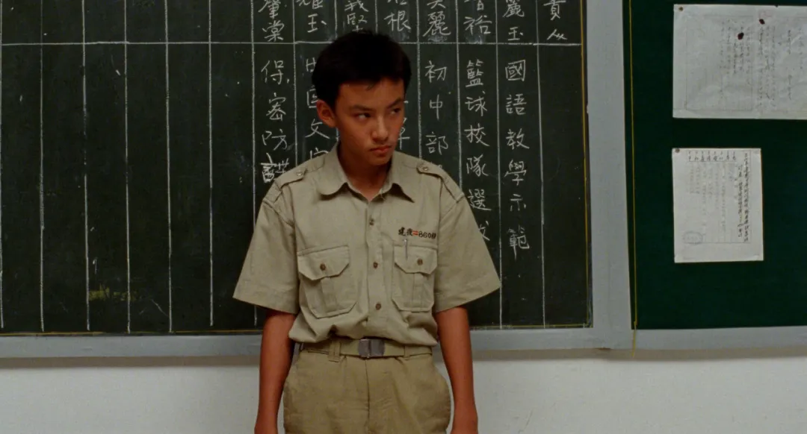
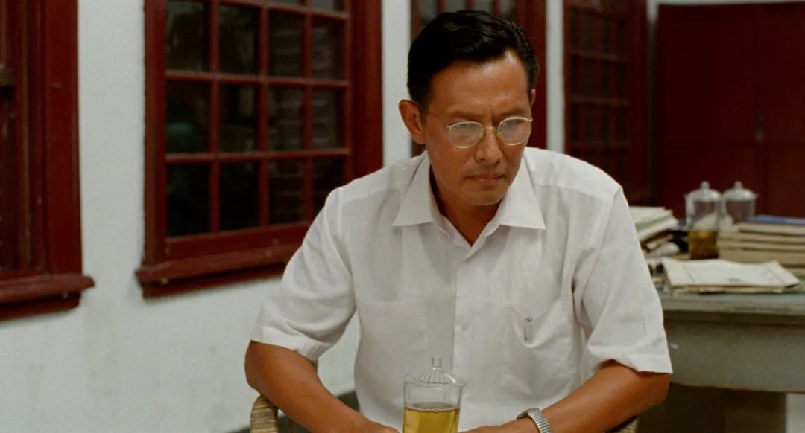
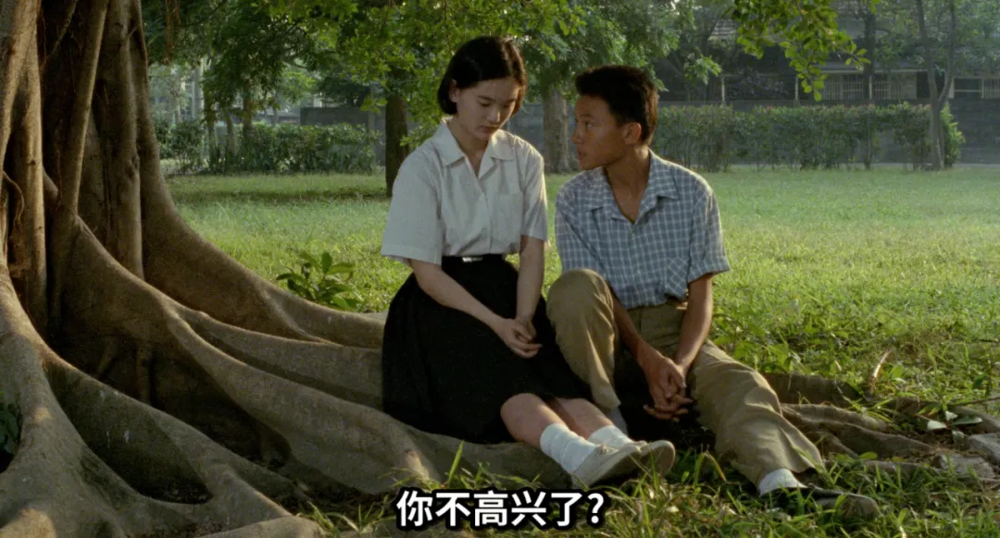
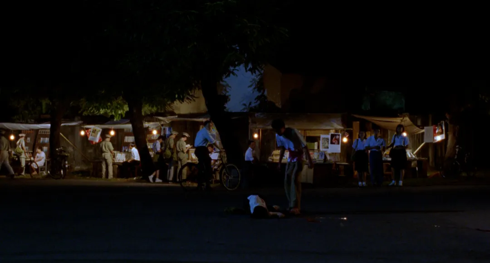
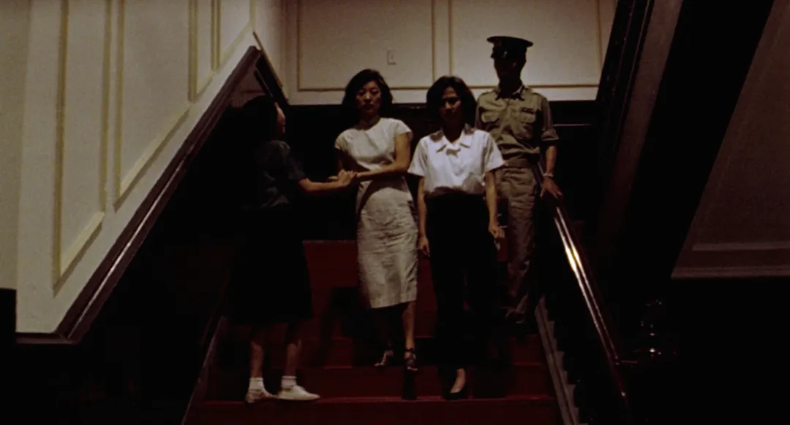

《牯岭街少年杀人事件》是一部长电影。几乎长达四小时，长电影对于观众来说既是享受，也是折磨。故事本身并不复杂——一宗少年杀人案件展开——然而导演却在有限的事件外包裹了大量看似“无关”的人物与情节。恰恰是这些“无关”，与案件本身的“有关”交织在一起，成就了这部电影的伟大。

许多类型电影往往选择聚焦案件本身，只呈现与主线直接相关的人和事。例如某些节奏紧凑的犯罪电影《花漾少女杀人事件》《消失的她》，时长可能只有九十分钟到一百分钟，叙事干脆利落、情节服务于故事。《牯岭街少年杀人事件》不是这样，影片利用宏大的篇幅，层层展开台湾社会的现实：家庭结构的压抑与失序、应试教育的焦虑与功利、政治环境的紧张与不确定。这些社会性因素并未以说教的方式出现，而是被自然地编织进少年们的日常之中。那些看似随意落笔的段落——街头、课堂、家庭争吵、政治广播——其实都是构成悲剧背景的土壤。它们并非真正的“无关之事”，而是案件发生所必须理解的现实条件。

影片关键的其实不是那一刀，而是少年张震在动刀之前所经历的一切。那是一代人尚未定型的年代，秩序摇晃，价值松动。少年们的启蒙往往集中在两个强烈的主题上：情欲与暴力。情感带来存在感，暴力带来确定性。在缺乏健全情感教育与安全家庭支撑的情况下，情欲被误读为占有，暴力被误当作肯定自己存在的方式。帮派成为庇护所，嫉妒与占有欲成为行动的理由，刀子成为表达情绪的极端工具。

电影中的几位少女在末尾所表达的那种质问“你以为你是谁？你想改变我的生活？”这句话看似是独立自由，彰显了女性的意识，但在我的解读里，是一种反讽，反讽人们无法在浪潮中决定自己的命运，更妄谈他人的命运，每个人都在被时代浪潮推搡前行。家庭、学校、政治氛围、社会期待，无时无刻不在塑造个体。人在其中行动，却并非完全出于自主意志——这既使人得以相互理解，也制造了无数冲突与误解。

这部电影同样照见了今天。现在我们在教育体系中习惯以成绩作为单一评价标准，资源倾斜明里暗里都在鼓励“精致的利己主义者”，说实话，我本人就是大学中这样评价体系中的一个失败者。资源往往向成功者倾斜，而社会宣传又同时要求奉献与牺牲。这样矛盾的结构，一方面让人乐此不疲地参与竞争，另一方面也在无形之中积累嫉妒、焦虑与敌意。人们就像潮水中的碎片，被浪花推到一起：有时拥抱，有时互殴。

悲剧并非只源于个人选择，也源于浪潮本身的方向。

《牯岭街少年杀人事件》不仅仅是讲述一宗少年情杀案。它通过一段私人悲剧，展现了一整套社会结构如何渗入个人命运：家庭的阴影、教育的压力、政治的不安、青春的不稳，交织成一张看不见的网。在这张网上，少年拼命证明自己存在与价值，最终却以毁灭方式完成了自我确认。

让我们看到，那一刀并非突兀的偶然，而是长久压抑与多重力量交汇后的必然爆裂，而爆裂与毁灭之后，是更深的迷茫与黑暗。

