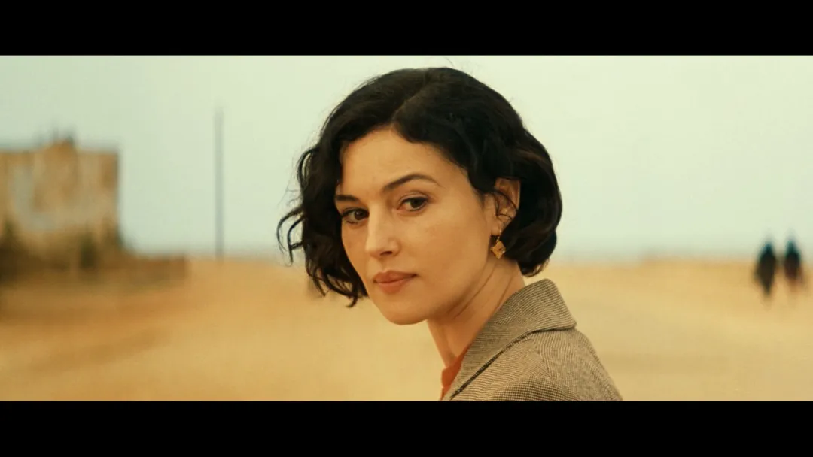
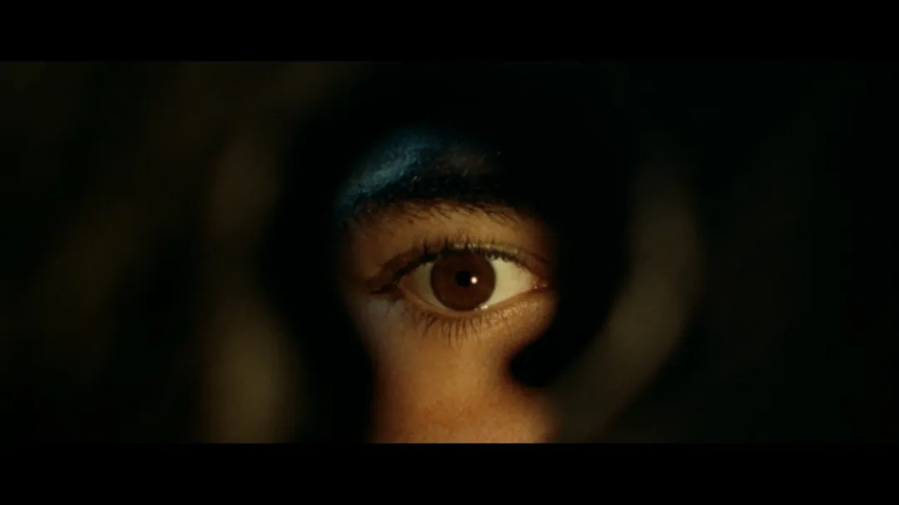
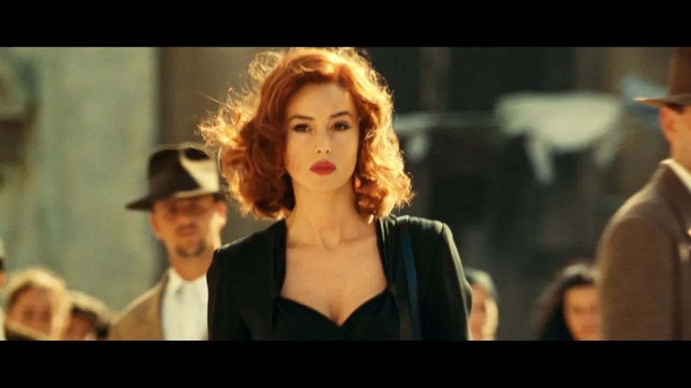
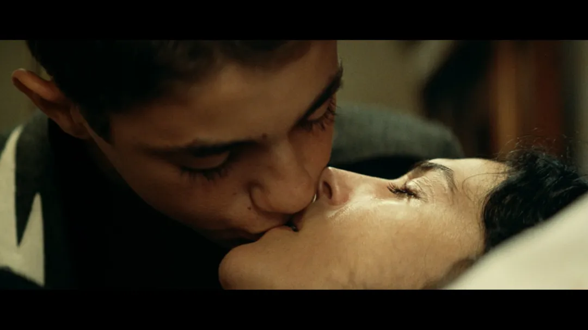
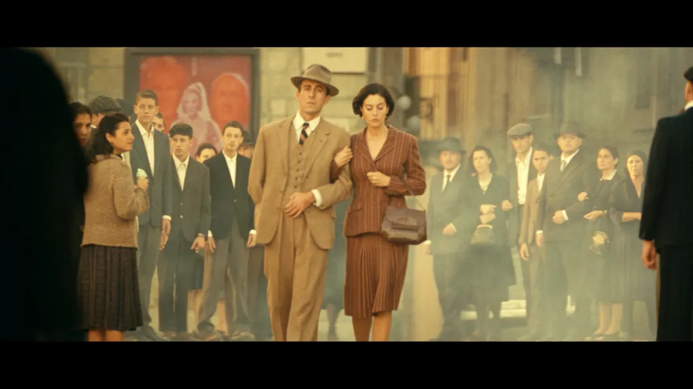
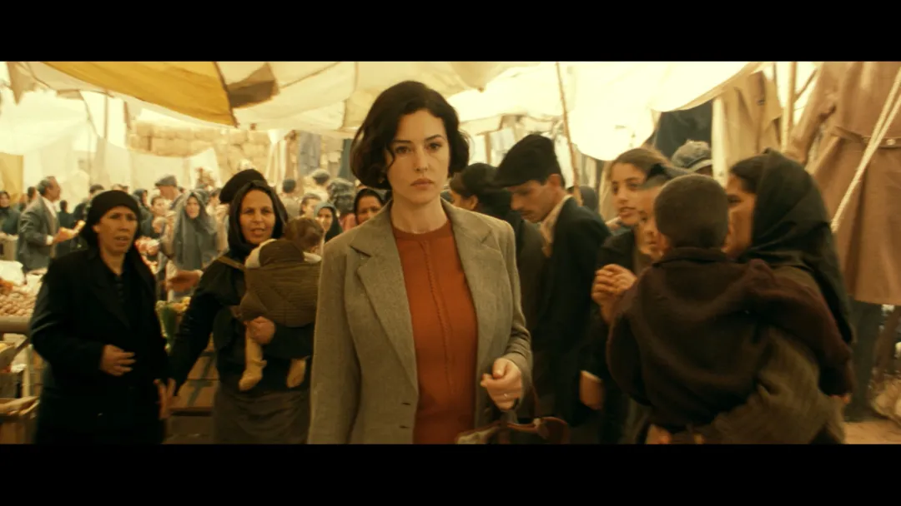

有一句话我经常同别人提起：语言即为思想的边界。  
很多时候，我们以为自己在思考，其实只是在语言已经铺好的轨道上来回行走。作为中文的使用者，尤其是在简体中文的语境中，语言本身所携带的思想密度，常常被忽略掉了。相较之下，在西方文化里，一些词汇由于长期的宗教与社会传统，被反复使用、不断沉淀，逐渐获得了类似中国成语那样稳定而顽固的指向性。

《Malèna》的中文译名《西西里的美丽传说》，从一开始就让我感到不适。“传说”这个词，天然地带着距离感与柔化效果，它让故事显得遥远、浪漫，甚至有些被时间与叙述美化过的意味，仿佛不过是海滨小镇流传已久的一段香艳闲谈，与现实的痛感无关。

也正是在这个层面上，这个译名在无意识中完成了一次极为精巧的偏移。观众尚未进入影片，心态却已经被安置在某种“事后”的位置上，仿佛一切都已经尘埃落定，只需静静欣赏一段注定令人唏嘘的往事。

“Malèna”，是一个纯粹的意大利女性名字。它在词源上指向抹大拉的玛利亚——那位在《圣经》中长期被误解、被污名化，又在后来被重新理解的女性形象。这个名字自诞生之初，便始终缠绕着几种难以分离的气质：美丽、孤立、被凝视、被议论，以及一种让世俗感到不安的危险性。托纳多雷选择这个名字，并非偶然，它几乎在影片开始之前，就已经为这个故事埋下了文化与命运的伏线。

故事发生在四十年代的西西里，锡拉库萨这样一个小镇，本身就像一只已经预热好的坩埚。地方不大，人与人之间几乎不存在真正的距离，每个人的生活都暴露在他人的目光之下。封闭并不会带来安宁，它只会放大一切——欲望、猜测、恶意，还有道德评判。再叠加上传统文化与天主教伦理，那些关于女性、贞洁、名声的观念早已内化为本能反应，不需要讨论，也不需要证明，只要有人“看见了”，判断就已经成立。法西斯统治和战争背景进一步抽空了社会的理性结构，权力、暴力和恐惧变成日常的一部分。在这样的环境里，美不再是一种私人属性，而是一种会不断被指认、被围观、被处置的公共事件。

电影选择从雷纳多的视角展开，并不是为了制造一个怀旧的青春故事。相反，这个视角更像一面不断折射的镜子，让你看见“观看”本身是如何一步步变质的。一开始，他只是一个被荷尔蒙牵着走的男孩。骑着自行车跟在她身后，用望远镜偷看，反复在脑海里编排那些并不存在的场景。这种凝视笨拙、直接，也带着羞惭，它仍然停留在想象层面，甚至可以说是天真的。

但很快，观看开始发生变化。远远地看已经不够了，他想靠近，想知道更多，想确认她究竟“是什么样的人”。于是有了跟踪，有了窥探，有了对她生活细节的执念。那一刻，她已经不再只是一个被仰望的存在，而变成了一个需要被拆解、被解释的对象。再往后，当她开始在生存的逼迫下出卖身体，观看里便掺进了另一种东西——猎奇、审视，还有一种隐秘的道德确认：原来如此。观看不再只是欲望，而开始为判断服务。

最可怕的变化发生在广场上。当暴力以集体的形式降临，观看本身成为惩罚的一部分。目光不再是旁观，而是参与。她被推到所有人面前，被撕扯、被羞辱，被一层层剥去作为“人”的可能性。雷纳多站在人群里，那一刻他终于意识到，观看并不是中性的，它可以杀人。之前所有偷偷摸摸、带着欲望的凝视，在这里完成了它们的终点。

雷纳多的成长并不光彩。他并不是突然变得清醒，而是被一步步裹挟进去。从一个带着负罪感的偷窥者，到一个被允许、被接纳的男性目光的一部分。他与玛莲娜那场仓促而沉默的性，并不是爱的实现，而更像是一种权力的交割。他得到了“成为男人”的证明，却是在一个已经被摧毁的人身上完成的。这份成人资格是污浊的。

雷纳多的父亲带他去妓院，用最直接的方式告诉他“男人是什么”；母亲在宗教与流言之间摇摆，她的焦虑与克制，同样是这个社会的一部分。与同龄男孩的相处，则让这种目光完成了集体化。他们分享她的照片，用下流的语言谈论她，在嘲笑与兴奋中彼此确认身份。与此同时，他们也轻易地嘲讽她的父亲——那位落魄的教授。在这个地方，知识与尊严无法提供保护，真正有效的只有粗野、权力和暴力。

雷纳多的眼睛，最终成了记录这场“社会性谋杀”的镜头。男人们利用职位、资源和谣言，一点点切断她的退路；女人们用议论和定性完成道德判决。当美军到来，所有压抑的情绪终于找到了出口，于是暴力被重新包装为爱国、纯洁与正义。在那一刻，美不再是被消费的对象，而是被彻底摧毁的目标。雷纳多第一次从“参与者”退回到“目击者”，他所迷恋的一切，在他眼前被撕碎。

从最初的远观，到偷窥，再到现实中那场毫无浪漫可言的性接触，他完成了所谓的成人礼。但这并不是胜利，而是幻灭。他触碰到的不是幻想中的女神，而是一个被集体消耗殆尽的人，甚至不及他任何一次幻想。他带走的不是爱情，而是一份沉默的见证和终身无法卸下的负担。他所接受的，正是这部电影最残酷的一课：美如何在集体中走向毁灭。

如果非要追问，这场悲剧究竟从哪里开始，其实很难指向某一个清晰的源头。它不像一场突如其来的事故，更像是一种早就写在环境里的必然走向。莲娜身上最致命的东西，美成了她的原罪。她的美过于醒目，醒目到无法被忽视，也无法被安置。男人在她身上投射欲望，却又需要通过贬损来解除自身的焦虑；女人在她身上看见威胁，于是将嫉妒包装成道德立场。她像一个被所有人围观却无处存放的存在，所有无法自处的情绪，最终都落在她身上。她并没有主动挑衅这个世界，但世界已经提前为她准备好了罪名。所谓“原罪”，并不是她做错了什么，而是她存在的方式本身就不被允许。

这一切发生在一个几乎不存在私人空间的地方。小镇生活并不意味着亲密，它意味着持续不断的暴露。没有秘密，也没有真正的事实，只有被反复转述、不断变形的故事。每个人都在看，也都在说，目光和语言彼此强化，最终形成一种无法逃脱的包围。偏离规范不需要证据，只需要被看见。谣言在这里不需要负责，它只需要足够响亮。暴力之所以可以顺利发生，正是因为它被包裹在“大家都知道”“大家都这么认为”的安全外壳里。

战争的背景让这一切进一步失控。秩序松动，道德变得可调节，生命的价值被不断压低。在这样的时刻，美丽却没有随之贬值，反而变得更加危险。没有男性庇护的女性，尤其是美丽的女性，被迅速拖入权力流转的轨道之中。她的身体成了现实变化最直观、也最廉价的承载物。从一方权力到另一方权力，她并未真正被“选择”，只是被不断接管。所谓的堕落，不过是生存空间被一步步压缩后的必然结果。

当一切尘埃落定，社会却反过来用道德的名义审判她，好像她的遭遇是某种个人失败的证明。可实际上，她只是站在了一个早已崩坏的系统之中，替所有人承受了后果。她的悲剧，并不只属于那个年代，也不只属于那个地方。只要美丽仍然被剥离出主体性，只要权力仍然可以通过观看、议论与占有完成自我确认，这样的故事就不会真正消失。

---

尼诺，Malèna的丈夫，他所遭遇的一切，并不复杂，也并不戏剧化，却异常沉重。他按着当时社会所认可的路径生活：参军、效忠、上前线，为国家承担风险。他失去了一条手臂，带着战争留下的身体缺口返回家乡，却发现整个世界已经换了叙事。政权倒塌，立场翻转，曾经被赞颂的忠诚，转眼成了需要被清算的标签。

更残酷的是，家乡并没有等他。那些在他缺席时占据他房产、羞辱他妻子、从混乱中获利的人，如今站在新的道德高地上，轻易地将失败与耻辱一并推给他这个“回来的人”。他失去的不只是手臂，还有解释自己人生的资格。他没有选择错阵营的权利，也没有重新书写历史的机会，只能被动地承受一切后果。

尼诺的悲凉，不在于他输掉了什么，而在于他从未参与过那场真正的肮脏游戏。那些留在后方、在秩序瓦解时迅速学会攫取利益的男人们。他们并不需要承担风险，却能在任何权力结构中找到自己的位置。相比之下，尼诺显得笨拙，甚至有些不合时宜。

他最后的选择，是整部电影中最安静、也最有重量的时刻之一。他没有追问，也没有审判，只是选择相信。他牵着莲娜的手回到这里，不是为了证明什么，更像是对自己过去生活的一次确认：那些曾经拥有的尊严、关系与记忆，并不因为被侮辱过就自动作废。这种相信，在那个语境下，几乎称得上是一种勇气。它不张扬，也不胜利，却拒绝继续配合世界的惯性。

影片的结尾，把所有暴力压缩进了一句再普通不过的寒暄里。当莲娜再次走过广场，那些曾经撕扯她、辱骂她的女人，像什么都没有发生过一样，向她问好。语气自然，表情从容，仿佛那场公开的羞辱只是某种已经翻页的插曲。莲娜短暂的停顿，几乎难以察觉，却比任何画面都更沉重。她低声回应，完成了这个社会所期待的“回归”。

正是在这一刻，电影显露出它最冷静、也最残忍的一面。那句问候不是修复，也不是宽恕，而是日常的重新启动。暴行被迅速归档，痛苦被视为已经处理完毕的事务。社会继续向前走，不需要解释，也不需要道歉。留下来承受的，只有当事人自己。原来集体的恶，如此轻易地转身。

《Malèna》到这里，已经完全脱离了任何“传说”的可能。它并不试图讲述一个关于美的故事，而是完整地展示了美如何在凝视中被制造，在议论中被消费，在权力面前被摧毁，最后被迅速遗忘。那个曾经躲在暗处偷看的少年，并没有站在故事之外。他只是比其他人更早地学会了观看。

这也是影片最令人不安的地方。雷纳多并非异类，他只是把我们习以为常的姿态提前演示了一遍。观看、议论、保持沉默，或者在合适的时候点头附和，这些看似无害的动作，最终共同构成了那场毁灭的条件。

所以问题并不只属于电影。在现实中，谁被允许成为“玛莲娜”，被反复谈论、被消费、被塑造成故事？而我们又在什么时候，毫不费力地站到了安全的位置上，成为那个手持望远镜的人，或者广场上安静的人群之一？

当痛苦被包装成“传奇”，被命名为“美丽的故事”，它就已经开始失真了。电影的原名《Malèna》，只是一个人的名字，一个无法被替代的个体。而《西西里的美丽传说》，听起来却轻巧、顺滑，适合被反复讲述、被售卖、被转述。正是在这两个名字之间，横亘着一条清晰的界线：一边是艺术对现实的直视，一边是消费对现实的安抚。

这条界线，或许才是整部电影真正想让人看见的东西。

