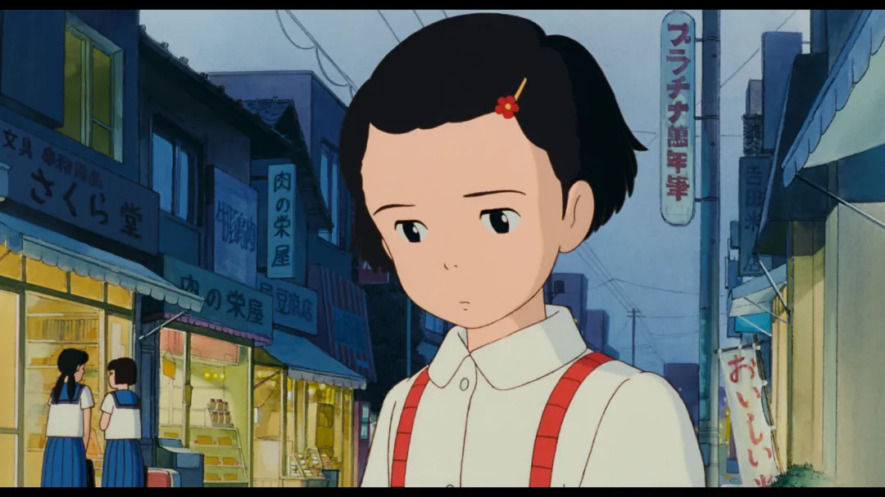
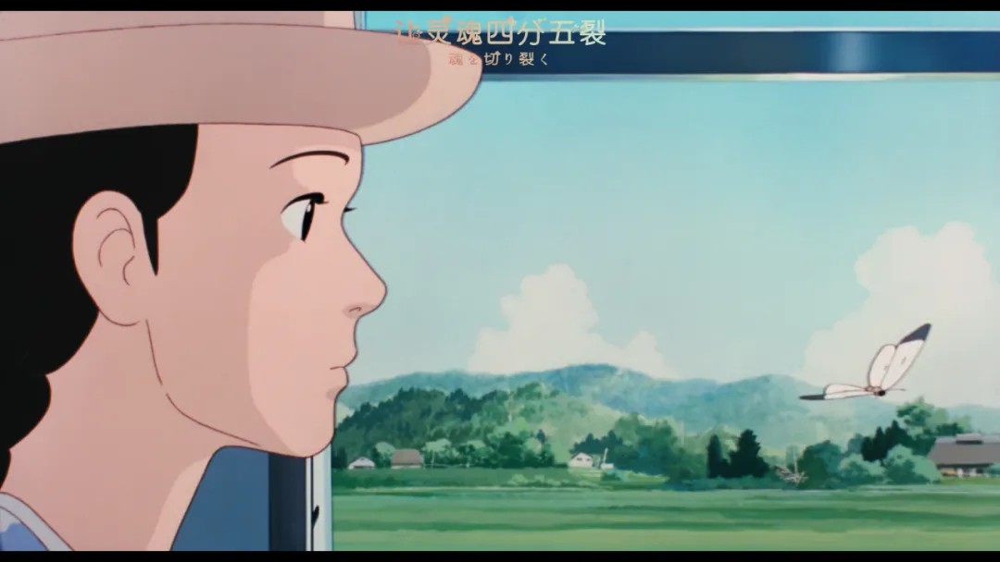
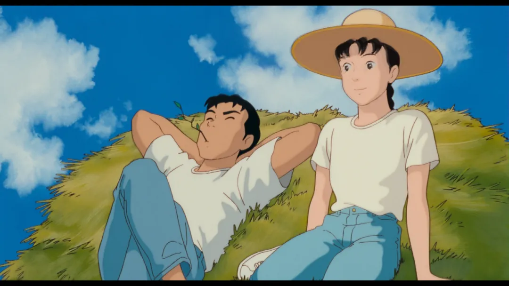
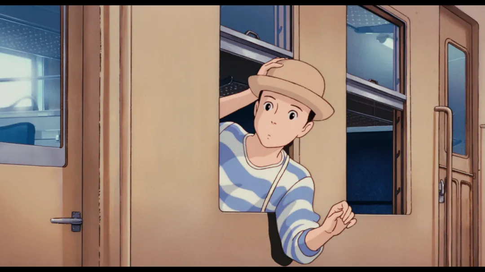
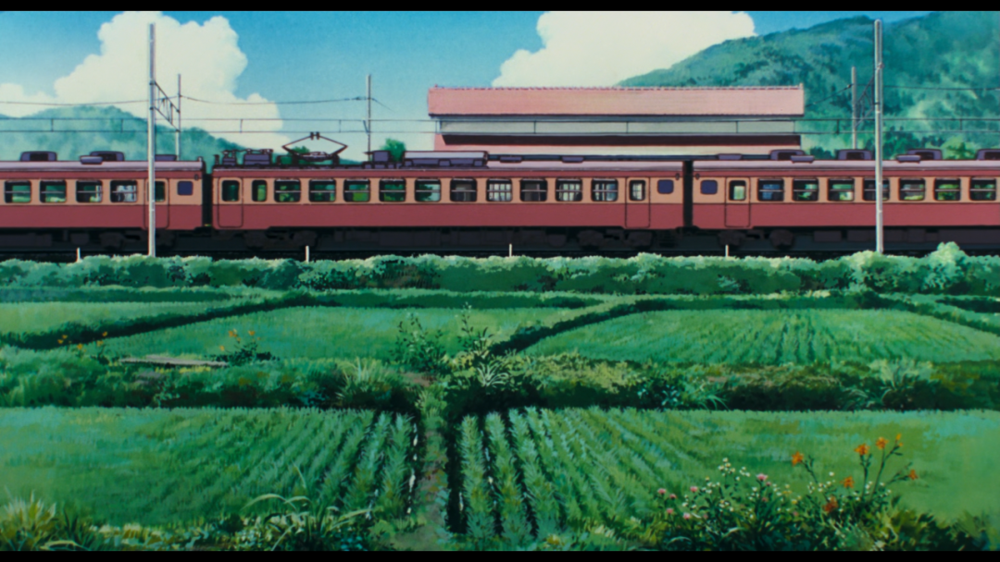

宫崎骏的电影《岁月的童话》上映于1991年，过了十年我才出生。但它一点也不过时。看完电影的末尾，我有很多感受，也反复在想，究竟该如何行文、从哪里切入，才是贴近我所想的说法。思绪一如既往地杂乱——看问题的角度太多，而正因为知道得太多，满心的缠缠绕绕，反而更难形成一种决绝、果断的判断。

妙子的童年并不自由。上学时期，她受到的是一种典型的家长制束缚：因为家里的决定，她不能参加大学的表演。宫崎骏并没有用尖锐的方式去控诉这种权威，而是让我们看到一个五年级小学生的委屈与难受。那种无法反驳、只能默默承受的情绪，本身就构成了一种抗议。

成年后的妙子来到乡村放松，她时常想起自己在东京读书的经历，又不断被乡村的节奏与风景打动。在这来回的对照中，城市对人的异化变得清晰起来。但电影并没有把乡村塑造成一种天然的乌托邦。乡村并不是自然本身，而是农民通过与自然长期对抗、妥协、劳动，才形成的一种田园诗。这一点让我非常受益，也提醒了许多城市视角中的隐秘傲慢。

电影里不肯握手，故意吐痰，装作大人模样的那位同桌。是一种拙劣的儿童幻想，却也是对成人世界的一次微弱反抗。孩子并不是真的想成为大人，而是已经隐约感受到，大人拥有权力。

这些观察与其说来自电影，不如说来自我自己。正因为我读了太多、了解了太多所谓“成熟”“深刻”“批判”的概念，我才会自然地从这些角度进入这部电影。正因为读了太多书、了解了太多所谓新奇成熟的概念，才会生出这般层层叠叠的解读。有朋友对我说，你正是因为懂得比别人多，才会用这些想法彰显自己的独特性。

但并不是这样。最近我经常对别人说，我怀念过去那个还不那么了解世界的自己，就像不知道双水村之外还有广阔天地的孙少安一样。

这些角度确实让我更理解这部电影，但它们并不会增加我的快乐，也不会增加我的感动。

《岁月的童话》是一部拍给大人看的电影，它让人想起自己五年级时的样子。我成熟得太早，却又记性太差，对待过往，也如许多中国人般：昔日龌龊不足夸，今朝浪漫思无涯。现在的人总是回忆过去，而过去的自己却在不停畅想未来。我们怀念的或许并不是那些具体发生过的事，而是那个单纯、幼稚的自己，以及那份未经世事打磨的、看待世界的纯粹眼光。

很多人喜欢标榜“单纯”，或轻易给别人贴上“单纯”的标签。但真正的单纯，应该更接近一种小学生式的幼稚。我非常喜欢“幼稚”“单纯”这样的词，在我这里毫无贬义，反倒是一种珍贵的特质。真正幼稚而单纯的人，往往急切地想证明自己已经成熟，对他人带着近乎歉意的示好——就像妙子那样。

我也在不断远离这种状态。记忆里，我第一次在深圳看到含羞草时，兴奋得不行，一定要把路边的叶子一片片碰合起来；等校车的时候，和伙伴一起玩斗陀螺。这些画面正在变得模糊，单纯也在一点点后退。

心头想说的话还有很多，可真正落笔时，才发觉言语的匮乏，许多心绪终究难以尽诉。人与人之间的交流本就不易，这般意识流的随笔，或许再过些日子回看，连自己都要琢磨许久才能懂当时的心境。就像那些模糊的过往，越想抓住，越易消散。

过往的岁月，究竟算不算童话？于当年还是小孩的我而言，答案定然是否定的。那时的日子，被老师家长的期许、写不完的作业层层包裹，有一次老师布置了一项极其不合理的罚抄，几乎不可能完成。我一直抄到凌晨一两点，也没能完成。第二天，这位老师却像完全忘记了这件事一样，照常上课，也没有检查罚抄。

童年并不浪漫，是后来才被整理成童话。

每个人曾经都是小孩，但遗忘是常态，记得是例外。

希望回望时，能再遇一次当年的自己，而非是居高临下的成人。

