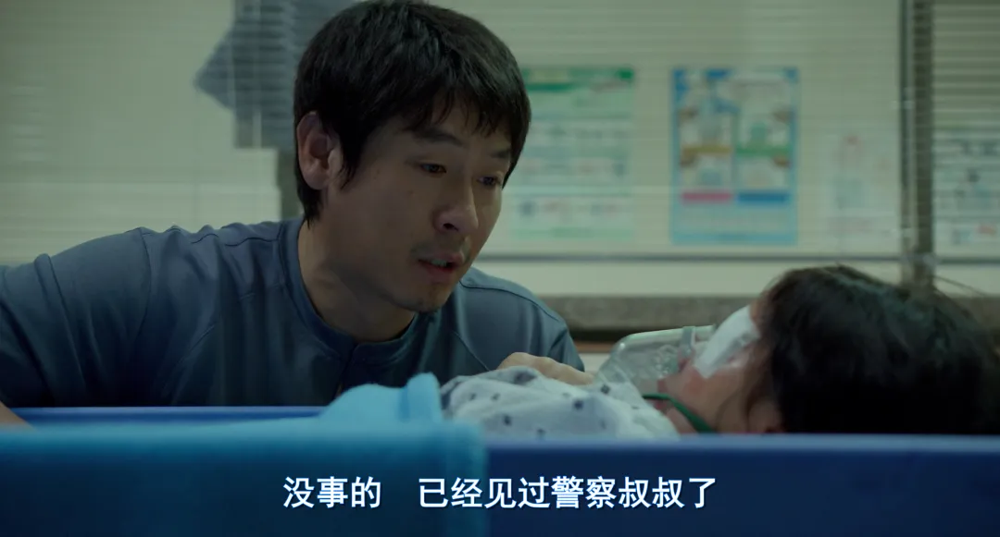
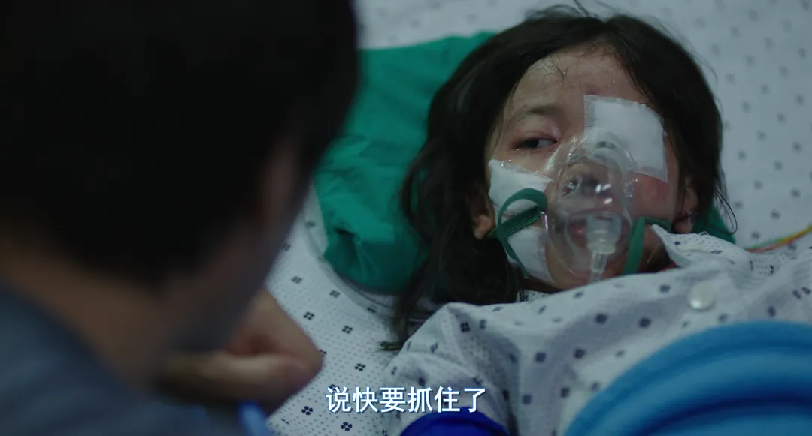
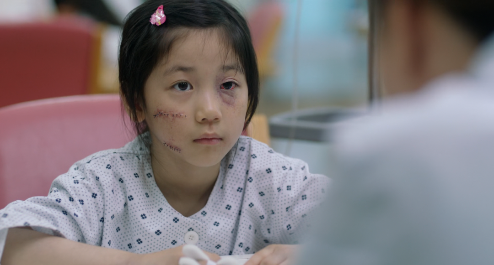
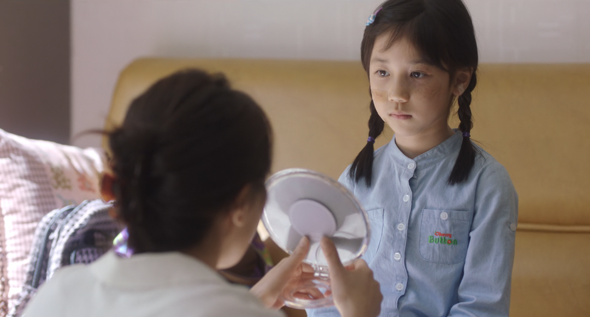
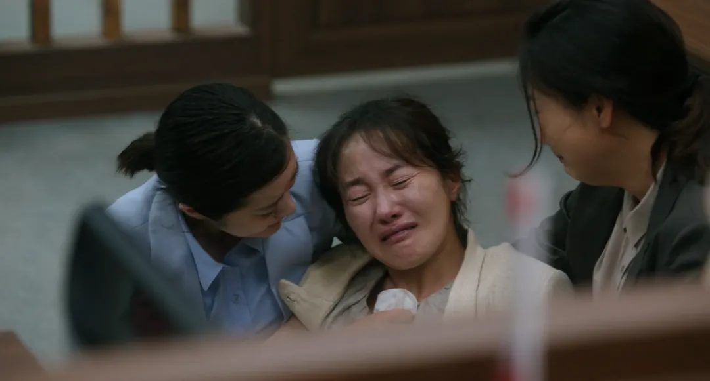
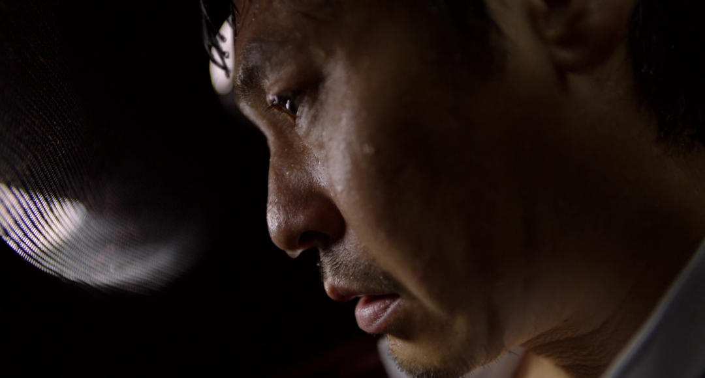

看完《素媛》，几次落泪。

我曾经相当确信，自己对大多数事情并没有太多情绪波动，像是站在世界的一侧，冷静地旁观。不是刻意克制，也不是自我标榜，只是习惯了用一种“不以物喜、不以己悲”的方式与外界保持距离。但这一次，我发现自己错了。  
人非木石，岂能无情。原来不是没有情感，而是一直被收拢着，在合适之前不轻易出现。

回到电影本身，《素媛》并没有将最残忍的细节反复铺陈，那些触目惊心的时刻被极为克制地一笔带过，叙事反而像流水一样，缓慢地流向事后的生活。影片关注的不是“发生了什么”，而是“在那之后，人如何继续活着”。  
在跳跃的明亮的卡通色彩衣服、卡通、书纸底下，是不能被掩盖的人的痛苦。悲伤没有消失，只是被放进了日常里。

我意识到，痛苦并不总是以剧烈、外放的方式存在，它更多时候是安静的，是被包裹着的，是在看似正常的生活中持续渗出的。

后来我查了这部电影所改编的真实案件。韩国政府为了监管那名被释放的罪犯，投入了高额成本，从制度和管理的角度看，这似乎已经是一种“应对”。许多人的情绪并没有因此得到安放，两套系统并不总在同一个维度里对话。  
情感并不总是服从于理性分析。很多时候，它的重量远远大于利害计算本身。

这一点让我不自觉地回到了自己身上。

我发现自己面对不适与冲突时，情绪的走向往往不是愤怒，而是难过。生气很少被外放，悲伤却常常在内部反复发酵。我会先否定自己的期待和设想，让希望提前落空，然后顺理成章地感到失望与难过。接着，我选择一种不合作的姿态，一种消极的对抗方式。  
这些并不是当时经过深思熟虑的决定，其实这种方式在很多时候都称不上是最优解，而是在事后回望时，才发现的一种惯性。

我开始问自己：这样的反应算不算一种软弱？  
还是说，在我所处的环境里，很多事情本就无法通过正面冲突改变，于是我学会了把情绪向内收拢，把失望留给自己？又或者，我是否在某些时刻，习惯通过沉浸于悲伤，期待被看见、被理解，从而间接改善自己的处境？

这些问题没有一个简单的答案。

我也不确定，这是否可以被称为一种“受害者心理”。  
也许真正重要的不是判断对错，而是承认——有些情绪并非软弱，也并非高尚，它们只是长期生活中形成的自我保护方式。

或许很多事不是关于正义、制度或愤怒，而是在看似平静、克制的表层之下，我仍然在真实地感受、承受、回应这个世界。

